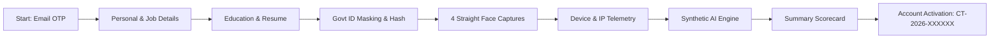

# Candidate Trust & Fraud Intelligence Platform (CandidateTrust AI)

> **"Verify the Person. Build Trust in Hiring."**  
> A next-generation platform that verifies candidate identity and detects hiring fraud using identity, biometric, device, network, and document signals.

---

## 🌟 Key Highlights & Security Architecture

1. **Zero-Trust Role Architecture**:
   - **No Frontend Role Selection**: There is only **ONE Common Login** page.
   - The backend strictly determines the user's role (`CANDIDATE`, `HR`, `ADMIN`) from the authenticated JWT session and encrypted database record.
   - Frontend role tampering is impossible.

2. **Email OTP Session Guard**:
   - Starting an application issues a demo OTP and a lightweight application session (`APP-XXXXXX`), auto-saving data at every step so refreshing or closing the browser never loses application progress.

3. **Privacy-Preserving Government ID Verification (DEMO/MOCK)**:
   - Evaluates Aadhaar, PAN, Passport, and Driving Licences.
   - **Never stores raw Aadhaar numbers**. Saves only masked representations (`XXXX-XXXX-7492`) and salted SHA-256 hashes (`HMAC-SHA256`).

4. **Straight-Facing Biometric Selfie Verification (DEMO/MOCK)**:
   - Captures 4 consecutive straight-facing frames with live orientation instructions (centered, lighting, steady camera).
   - Strict straight-facing policy with zero tilt/head-turn requirements.
   > **Note on Biometric Prototype**:  
   > *Three or four straight-facing photos are only a prototype verification flow. Production systems should use active liveness detection such as blink/head movement or an authorized biometric vendor SDK.*

5. **Device & IP Intelligence Telemetry**:
   - Evaluates client IP, proxy/datacenter detection, browser, OS, and sudden session anomalies as supporting risk signals.

6. **Synthetic Identity Anomaly Engine**:
   - Multi-signal correlation combining name/DOB consistency, disposable email domain filters, phone carrier reputation, and account age. Suspicious signals result in **"Needs Review"** (never automated fraud rejection).

7. **Candidate Trust Passport**:
   - Upon completion, candidates activate their account and receive a unique Candidate ID (`CT-2026-XXXXXX`).

8. **Minimal HR / Admin Review Ledger**:
   - Clean inspection ledger displaying candidate statuses, deep inspection drawer with all 11 signals, and human-in-the-loop review actions (*"Flag for Review"* or *"Approve as Verified"*).

---

## 🚀 Quick Start Guide

### 1. Start the Backend Server (Port 5000)
```bash
cd backend
npm install
npm start
```
The server will start at `http://localhost:5000`, auto-initialize the SQLite database schema, and seed demo accounts.

### 2. Start the Frontend Development Server (Port 5173)
```bash
cd frontend
npm install
npm run dev
```
Open `http://localhost:5173` in your browser.

---

## 🔑 Demo Credentials (`DEMO_MODE=true`)

The platform includes pre-seeded demo accounts with 1-click autofill on the login page:

| Persona | Email / Identifier | Password | Access & Purpose |
| :--- | :--- | :--- | :--- |
| **HR Manager** | `hr@demo.com` | `Demo@1234` | Candidate Review Ledger, Signal Inspector, Decisioning |
| **Security Admin** | `admin@demo.com` | `Demo@1234` | Full Fraud Intelligence & System Audit Trail |
| **Candidate Demo** | `candidate@demo.com` | `Demo@1234` | Verified Candidate Passport (`CT-2026-784920`) |
| **Demo OTP** | — | `749281` | Standard OTP code for all email/MFA verifications |

---

## 📊 Application Verification Pipeline (11 Signal Vectors)



---

## 🛡️ Tech Stack

- **Frontend**: React (Vite), Tailwind CSS, Framer Motion, Lucide Icons, Canvas WebRTC / Camera.
- **Backend**: Node.js, Express, SQLite (`sqlite3`), JWT, bcryptjs, Helmet, Express-Rate-Limit, Multer.
- **Security**: Salted SHA-256 ID hashing, server-side JWT RBAC, structured audit logging.

